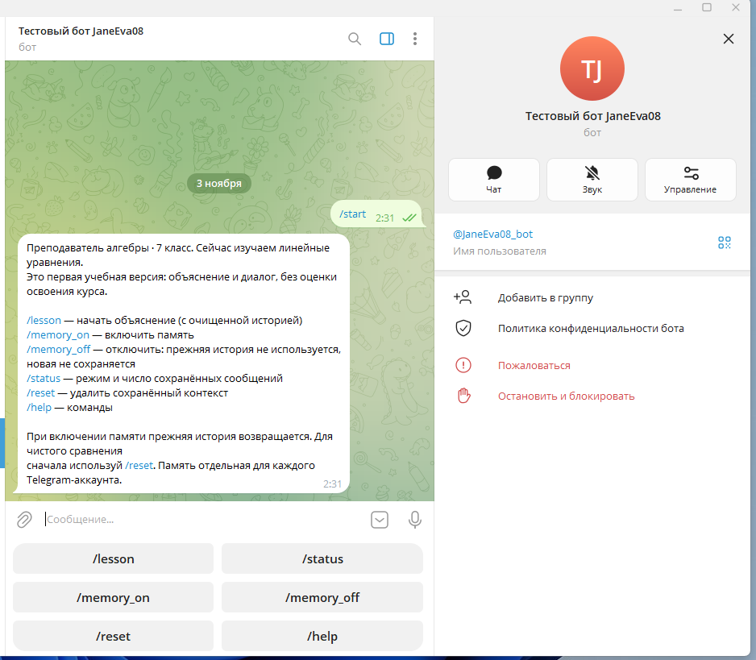
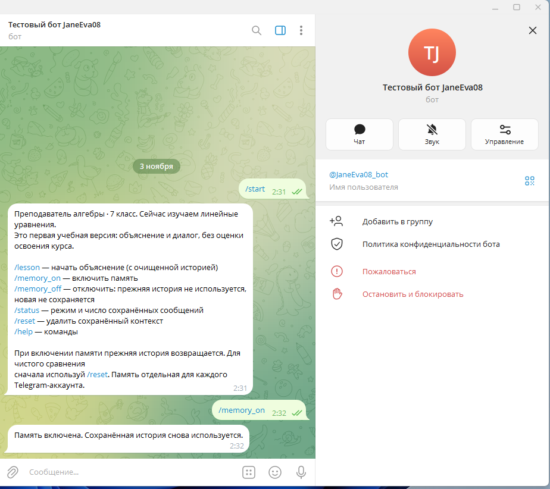
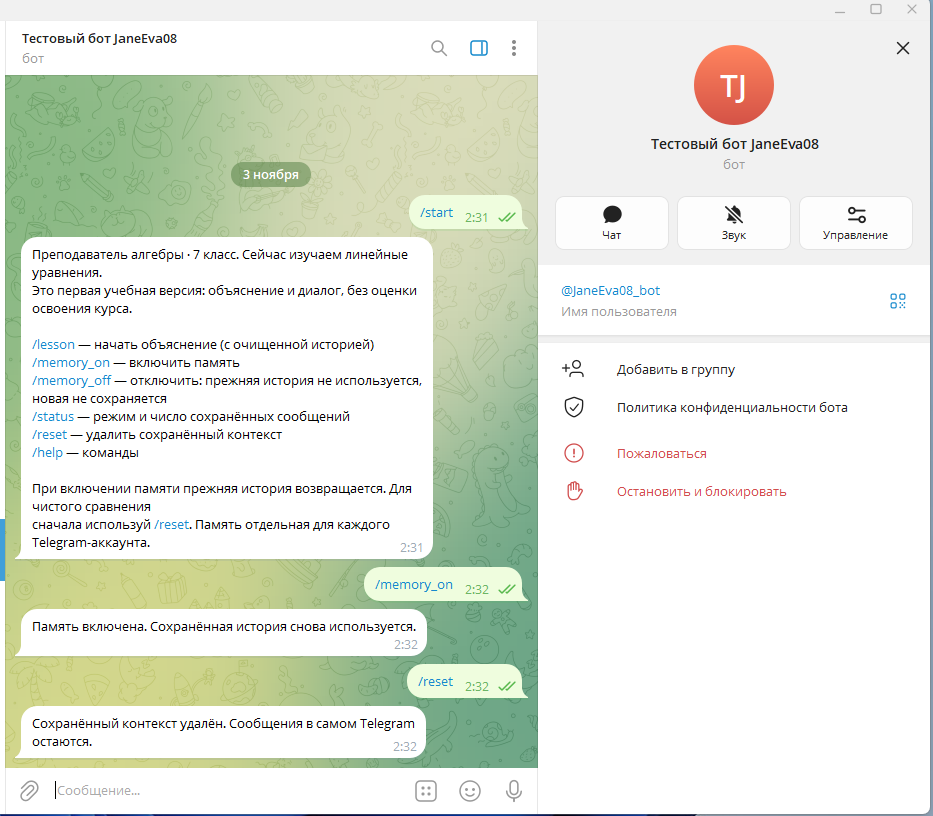
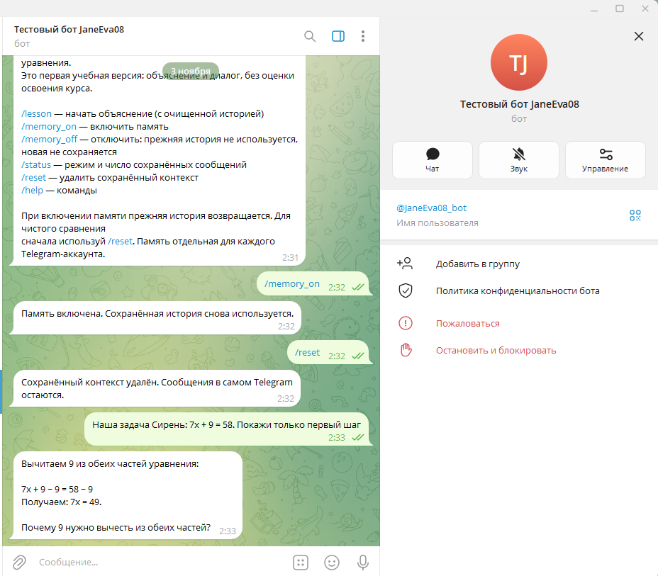
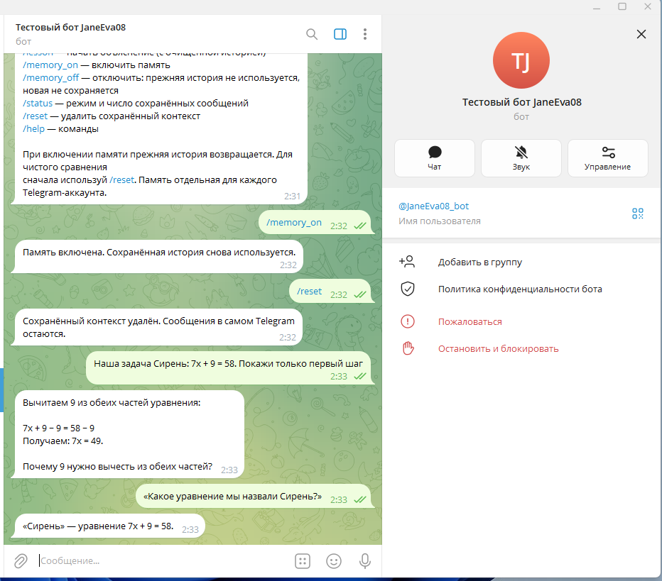
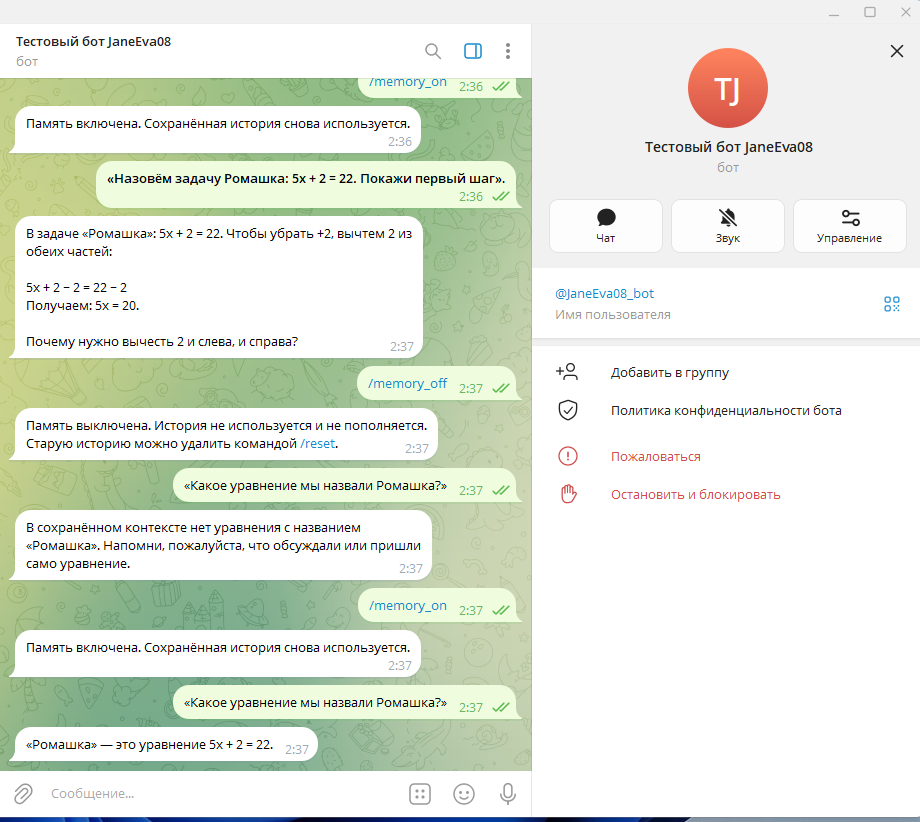
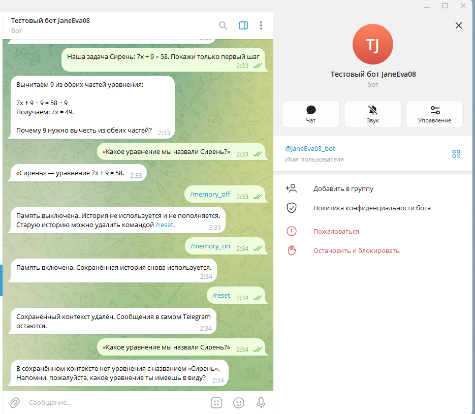
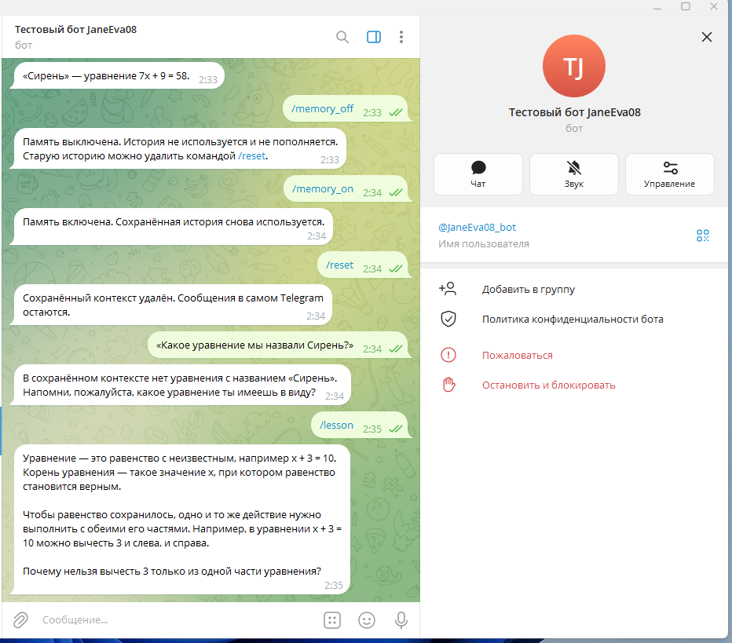

# Отчёт по заданию VPg01 — память LLM

## Задание

Сравнить работу бота с памятью и без неё. Реализовать хранение контекста
в базе данных, восстановление после перезапуска и команду очистки памяти.

## Реализация

Создан Telegram-преподаватель алгебры для 7 класса на Python.
Для сравнения используются два режима одной модели с одинаковым
учебным материалом по линейным уравнениям:

- `/memory_on` — предыдущие сообщения используются в ответах, новые сохраняются;
- `/memory_off` — история не передаётся модели и не пополняется;
- `/reset` — сохранённая история пользователя удаляется.

SQLite хранит последние 20 пар «вопрос — ответ» отдельно для каждого
Telegram-пользователя. При следующем запросе, в том числе после
перезапуска программы, история считывается с диска и добавляется
в системный промпт как цитируемый контекст. Объём передаваемой истории
ограничен 16000 символами; старейшие целые пары исключаются.

Отключение памяти не удаляет историю: после включения она снова
используется. Очистка базы не удаляет сообщения из самого Telegram.

## Запуск бота

Команда `/start` показывает описание преподавателя, команды и кнопки
управления памятью.

## Включение памяти

Команда `/memory_on` включает использование и сохранение истории.
Бот подтверждает выбранный режим.

Перед проверкой команда `/reset` очищает предыдущий контекст.

## Диалог с памятью

Боту передана задача «Сирень: 7x + 9 = 58» с просьбой показать только
первый шаг. Бот вычел 9 из обеих частей, получил `7x = 49` и задал
вопрос на понимание, не выдавая полное решение.

На последующий вопрос «Какое уравнение мы назвали Сирень?» бот
восстановил точное условие: `7x + 9 = 58`. Повторять условие не потребовалось.

## Сравнение режимов без удаления истории

В режиме с памятью боту передана новая задача «Ромашка: 5x + 2 = 22».
После `/memory_off` бот не смог вспомнить её и попросил напомнить условие.
Затем память включена командой `/memory_on` без очистки. На тот же вопрос
бот точно ответил: `5x + 2 = 22`.

Проверка показывает различие между отключением памяти и её удалением:
выключенная история сохраняется в SQLite, но не передаётся модели.

## Очистка памяти

После `/reset` вопрос о задаче «Сирень» больше не привёл к восстановлению
уравнения. Бот сообщил об отсутствии условия в контексте и попросил
его напомнить. При этом старые сообщения остались видны в Telegram.

## Начало учебного занятия

Команда `/lesson` запускает объяснение: бот определяет уравнение и его
корень, объясняет одинаковые действия над обеими частями и задаёт один
вопрос на понимание.

## Дополнительные проверки

Восстановление после перезапуска проверено через реальный API модели
`gpt-6-luna`: отдельный процесс Python загрузил историю из SQLite
и восстановил уравнение `7x + 9 = 58`. Для другого пользователя прежнее
уравнение не было доступно. Всего выполнено 5 реальных запросов модели.

Пройдено **8 автоматических тестов** с реальной временной SQLite
и подменой внешних сервисов: восстановление истории, режим без памяти,
изоляция и очистка, ограничения контекста и входа, обработка пустых
ответов и ошибок API, команды и доступ.

## Вывод

Память позволяет продолжать разговор без повторной передачи условия
задачи и сохраняет контекст между запусками. Без памяти бот обрабатывает
вопрос отдельно и просит уточнить прежнее условие. Команда очистки
позволяет начать новый диалог, не используя предыдущую историю.
